# TestPilot — High-Level Design (HLD)

**Project:** TestPilot (AI-Powered API Testing Assistant)  
**Milestone:** Phase 6: Final Hardening & Project Assessor Readiness  
**Document Version:** 6.0.0  

---

## 1. System Architecture Overview

TestPilot is structured as a decoupled multi-tier system. In Phase 5, the architecture introduces two critical subsystems:
1. **Real-Time WebSocket Engine (Socket.IO):** Attached directly to the existing Express HTTP server on port `5000`, enabling sub-20ms event broadcasting across 9 agent state transitions, room subscriptions, client reconnection handling, and payload credential sanitization.
2. **LLM Evaluation Benchmark Framework:** A deterministic, reproducible evaluation engine that executes model test generation against fixed ground-truth benchmark datasets (`benchmark-v1.json`, 16 cases), calculates objective metric scores across 5 quality dimensions, and persists evaluation runs in PostgreSQL.
3. **Interactive Evaluation Dashboard:** A dedicated frontend section displaying dataset specifications, overall score badges, quality metric breakdowns, case-by-case comparison tables against reference tests, and run history.

```mermaid
flowchart TD
    subgraph ClientTier["Client Tier (:5173)"]
        UI["React + Vite Single Page Application"]
        SocketClient["Socket.IO Client (services/socket.js)"]
        AiAgentUI["AI Investigation Panel (WebSocket Live Stream)"]
        EvalDashboard["LLM Evaluation Benchmark Dashboard"]
        SpecWorkspace["OpenAPI Spec Workspace"]
        
        UI --> SocketClient
        UI --> EvalDashboard
        UI --> SpecWorkspace
        SpecWorkspace --> AiAgentUI
    end

    subgraph BackendTier["Core Backend Tier (:5000)"]
        HttpServer["Node.js HTTP Server (http.createServer)"]
        ExpressApp["Express Core Application"]
        SocketServer["Socket.IO Engine (server/src/socket/)"]
        
        HttpServer --> ExpressApp
        HttpServer --> SocketServer
        
        subgraph RealtimeSubsystem["Real-Time WebSockets Engine"]
            RoomManager["Room Partitioning (investigation:runId)"]
            Sanitizer["Payload Sanitizer & Secret Redactor"]
            EventEmitter["Agent Event Broadcaster (9 Event Types)"]
            
            SocketServer --> RoomManager
            RoomManager --> Sanitizer
            Sanitizer --> EventEmitter
        end

        subgraph EvaluationSubsystem["LLM Evaluation Framework (server/src/eval/)"]
            BenchmarkDatasets["Ground-Truth Datasets (benchmark-v1.json, 16 Cases)"]
            ScoringEngine["Deterministic Metric Engine (5 Quality Dimensions)"]
            EvalRunner["Benchmark Runner & Persistence Orchestrator"]
            
            BenchmarkDatasets --> ScoringEngine
            ScoringEngine --> EvalRunner
        end

        subgraph RagSubsystem["RAG & Vector Retrieval (server/src/rag/)"]
            Chunker["Semantic Spec Chunker"]
            EmbeddingService["Embedding Service (768-dim text-embedding-004)"]
            VectorStore["Vector Store (Postgres pgvector)"]
            RetrievalService["Retrieval & Context Synthesizer"]
            
            Chunker --> EmbeddingService
            EmbeddingService --> VectorStore
            VectorStore --> RetrievalService
        end

        subgraph AgentSubsystem["Autonomous Agent Subsystem (server/src/agent/)"]
            AgentOrchestrator["Agent Orchestrator State Machine"]
            AgentTools["Controlled Function Calling Tools"]
            
            AgentOrchestrator --> AgentTools
            AgentOrchestrator --> EventEmitter
        end

        subgraph ExecutionSubsystem["Execution & Diagnosis (server/src/)"]
            TestRunner["Sandbox Test Runner (:4000)"]
            FailureExplainer["AI Failure Explainer"]
            
            TestRunner --> EventEmitter
            FailureExplainer --> EventEmitter
        end
    end

    subgraph StorageTier["Data & Persistence Tier"]
        Postgres["PostgreSQL 16 (:5433)"]
        Pgvector["pgvector Extension (768-dim Vectors)"]
        EvalTables["evaluation_runs & evaluation_case_results"]
        ExecutionTables["test_execution_runs & test_case_results"]
        
        Postgres --> Pgvector
        Postgres --> EvalTables
        Postgres --> ExecutionTables
        
        VectorStore --> Postgres
        EvalRunner --> Postgres
        TestRunner --> Postgres
    end

    subgraph SandboxTier["Target Sandbox API (:4000)"]
        SandboxApp["Express In-Memory Sandbox"]
        UsersRoutes["GET, POST, DELETE /users"]
        
        TestRunner --> SandboxApp
    end

    SocketClient <--> SocketServer
    UI <--> ExpressApp
```



---

## 2. WebSocket Real-Time Communication Architecture

### 2.1 Co-Located Single Server Design
To avoid CORS complexities, proxy misconfigurations, and multiple listening ports, Socket.IO is attached directly to the existing Express HTTP server on port `5000`:
```javascript
const httpServer = http.createServer(app);
const io = initSocketIO(httpServer);
```

### 2.2 Room-Based Scoping & Security
Clients subscribe to a specific investigation run using the `join-investigation` event:
- **Room Key:** `investigation:${runId}`
- **Security Check:** Validates `runId` format (`/^[a-zA-Z0-9_-]{4,100}$/`). Malformed identifiers are immediately rejected without entering a room.
- **Unsubscription:** Supported via `leave-investigation` or automated on client disconnection.

### 2.3 Automated Payload Sanitization
Before any event payload is emitted across WebSockets, it passes through `sanitizePayload()`:
- Recurses through nested objects and arrays up to depth 6.
- Matches sensitive key patterns (`apiKey`, `secret`, `password`, `token`, `auth`, `credentials`).
- Replaces Google Gemini API key strings matching `/AIzaSy[0-9A-Za-z_-]{20,40}/g` with `[REDACTED_API_KEY]`.

---

## 3. LLM Evaluation Framework Architecture

### 3.1 Benchmark Dataset Design
Located in `server/src/eval/datasets/benchmark-v1.json`:
- **Fixed Ground Truth:** 16 rigorously curated test cases covering all 4 sandbox endpoints (`/users`, `/users/{id}`, `POST /users`, `DELETE /users/{id}`) across positive, negative, and boundary scenarios.
- **Reference Contracts:** Each benchmark case contains explicit expectations for HTTP method, URL path, expected status codes, required conditions, and complete reference test case definitions.

### 3.2 Objective Deterministic Metric Engine
Unlike subjective LLM-as-a-judge scorers, TestPilot evaluates generated tests using an objective, reproducible metric formula:

$$\text{Overall Score} = (0.20 \times V_{\text{schema}}) + (0.20 \times A_{\text{endpoint}}) + (0.20 \times A_{\text{method}}) + (0.25 \times A_{\text{status}}) + (0.15 \times C_{\text{category}})$$

1. **Schema Validity ($20\%$):** Evaluated via Zod `TestCaseSchema.safeParse()`.
2. **Endpoint Accuracy ($20\%$):** Path template matching and parameter placeholder alignment.
3. **Method Accuracy ($20\%$):** HTTP verb equality check.
4. **Status Accuracy ($25\%$):** Expected response status code match against OpenAPI contract.
5. **Category Coverage ($15\%$):** Verification that positive, negative, and boundary scenarios were produced.

---

## 4. PostgreSQL Persistence Architecture

The PostgreSQL database (running on port `5433` via Docker Compose) persists both runtime agent executions and standardized benchmark evaluations:
- `evaluation_runs`: Stores overall score, individual metric rates, dataset ID, case counts, and completion timestamps.
- `evaluation_case_results`: Stores individual benchmark case assertions, generated test comparisons, schema validity, status matches, and scores.
- `api_chunks`: Stores semantic documentation chunks and 768-dimensional pgvector embeddings.
- `test_execution_runs` & `test_case_results`: Stores live sandbox execution results and AI failure diagnoses.
